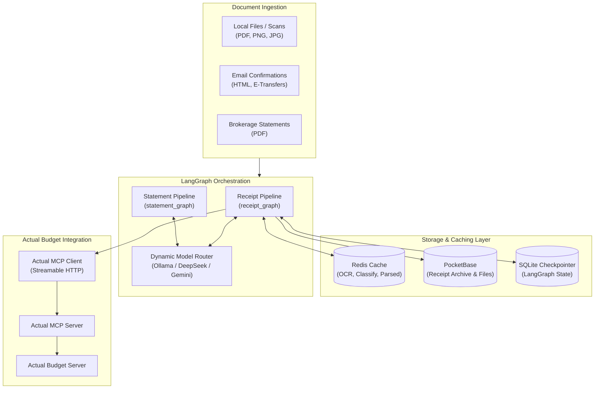
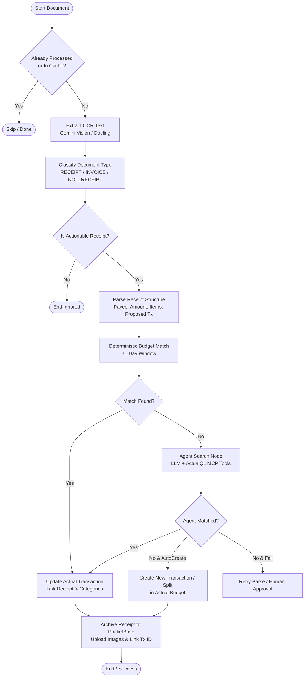

# Actual Orchestrator (actual-orch)

[](https://python.org)
[](https://github.com/langchain-ai/langgraph)
[](https://modelcontextprotocol.io)
[](LICENSE)

An agentic, multi-model document orchestration and budget reconciliation engine for [Actual Budget](https://actualbudget.com/).

Powered by [LangGraph](https://github.com/langchain-ai/langgraph), [Model Context Protocol (MCP)](https://modelcontextprotocol.io), and state-of-the-art vision and language models (Gemini, DeepSeek, local Ollama models, and OpenAI), `actual-orch` automatically ingests financial documents (receipts, digital invoices, order confirmations, e-transfers, investment statements), classifies them, matches them to bank transactions, and reconciles your budget.

---

## Key Features

- **Autonomous Multi-Agent Pipelines**:
  - **Receipt Pipeline (`receipt_graph`)**: End-to-end receipt extraction, document classification, line item extraction, fuzzy/deterministic transaction matching, split-transaction generation, and archive sync.
  - **Statement Pipeline (`statement_graph`)**: Ingests multi-page brokerage and bank statements, extracts ledger tables using Docling/pdfplumber, and normalizes buy/sell/dividend/interest transactions.
- **Dynamic Multi-Model Routing**:
  - Configurable model tiers (`config/models.json` & `config/agents.json`).
  - Routes lightweight tasks (e.g. classification, local search) to fast local models (e.g. Ollama `qwen2.5:7b`) to minimize latency and API costs.
  - Automatically escalates complex parsing and ambiguity resolution to frontier models (DeepSeek-V4-Pro, Gemini 3.1 Pro).
- **Peak Hour Throttling & Cost Optimization**:
  - Aware of provider peak pricing windows (`config/peak_hours.json`), automatically pausing or falling back during high-cost intervals.
- **Multi-Tier Content Caching**:
  - Redis-backed content-hash caching (`receipt:hash:ocr`, `receipt:hash:classify`, `receipt:hash:parsed`) ensures re-processing the same document skips expensive vision/LLM calls.
- **Actual Budget MCP Integration**:
  - Communicates directly with the `actual-mcp` server using the Streamable HTTP transport protocol.
  - Employs deterministic window searches followed by autonomous agent searches with ActualQL query tools to resolve fuzzy dates, tips, discounts, and split payments.
- **Persistent State & Auditability**:
  - Stateful graph execution with `AsyncSqliteSaver` checkpointer for step replay, failure recovery, and human-in-the-loop validation.
- **PocketBase Receipt Archiving**:
  - Automatically uploads receipt images, PDFs, line items, and transaction links to a central PocketBase database.

---

## Architecture



---

## Receipt Processing Workflow



---

## Getting Started

### Prerequisites

- **Python**: `3.11` or higher
- **Redis**: Running instance for document and LLM response caching
- **Actual MCP Server**: An active `actual-mcp` instance running on HTTP transport (e.g. `http://localhost:3000/mcp`)
- **API Keys**: One or more of Google Gemini, DeepSeek, OpenAI, or a local [Ollama](https://ollama.com/) instance

### Installation

```bash
git clone https://github.com/your-username/actual-orch.git
cd actual-orch
python3 -m venv .venv
source .venv/bin/activate
pip install -r requirements.txt
pip install -e .
```

---

## Configuration

### Environment Variables

Copy the example environment template:

```bash
cp .env.example .env
```

| Variable | Description | Default |
|---|---|---|
| `ACTUAL_MCP_ENDPOINT` | Streamable HTTP endpoint of the `actual-mcp` server | `http://localhost:3000/mcp` |
| `REDIS_URL` | Redis connection URL | `redis://localhost:6379/0` |
| `PB_UPLOAD_BASE_URL` | Base URL for PocketBase receipt archiving (optional) | `http://localhost:8090` |
| `PB_USER` | PocketBase account username/email | — |
| `PB_PASSWORD` | PocketBase account password | — |
| `GEMINI_API_KEY` | Google Gemini API key (used for vision OCR) | — |
| `DEEPSEEK_API_KEY` | DeepSeek API key (used for structured receipt parsing) | — |
| `OPENAI_API_KEY` | OpenAI API key (optional) | — |
| `OLLAMA_BASE_URL` | Base URL for local Ollama server | `http://localhost:11434` |
| `ALLOW_PEAK_HOURS` | Set to `1` to allow execution during configured peak hours | `0` |

### Configuration Files (`config/`)

All routing, models, and prompts are externalized into JSON files:

- **`config/models.json`**: Provider definitions, base URLs, and model mappings for Ollama, DeepSeek, Google, and OpenAI.
- **`config/agents.json`**: Per-pipeline step model allocation and fallback chains (e.g., `receipt_extract`, `receipt_classify`, `receipt_parse`, `budget_search`).
- **`config/classification.json`**: Rules and prompt definitions for document types (`RECEIPT`, `INVOICE`, `ORDER_CONFIRMATION`, `SHIPPING_CONFIRMATION`, `NOT_RECEIPT`).
- **`config/peak_hours.json`**: Time window definitions for peak pricing schedules.

---

## Usage

### Invoking Receipt Pipeline Programmatically

```python
import asyncio
from actual_orch.graphs.receipt import receipt_graph
from actual_orch.graphs.manager import compile_workflow

async def process_document(pdf_path: str):
    db_path = "data/checkpoints/receipts.sqlite"
    
    async with compile_workflow(receipt_graph, db_path=db_path) as (processor, _):
        initial_state = {
            "file_path": pdf_path,
            "source": "file",
            "source_ref": pdf_path,
            "flag_create_missing": False,
            "flag_skip_auto_match": False,
        }
        
        config = {"configurable": {"thread_id": pdf_path}}
        result = await processor.ainvoke(initial_state, config=config)
        print("Pipeline Status:", result.get("status"))
        print("Matched Tx ID:", result.get("actual_tx_id"))

if __name__ == "__main__":
    asyncio.run(process_document("sample_receipt.pdf"))
```

### Cache & Checkpoint Utilities

The package provides utility modules for managing Redis caches and SQLite checkpoints:

```python
from actual_orch.utils.cache_ops import clear_redis_cache, prune_orphaned_keys
from actual_orch.utils.checkpoint_ops import clear_all_checkpoints

# Clear OCR cache
clear_redis_cache(prefix="receipt_", cache_type="ocr")

# Clear specific checkpointer database
clear_all_checkpoints("data/checkpoints/receipts.sqlite")
```

---

## Project Structure

```
actual-orch/
├── config/                     # Externalized JSON configurations
│   ├── agents.json             # Step-to-model allocation & retries
│   ├── classification.json     # Document classification rules
│   ├── models.json             # LLM provider definitions
│   └── peak_hours.json         # Throttling time windows
├── actual_orch/
│   ├── clients/                # MCP, Redis, and PocketBase clients
│   │   ├── cache.py
│   │   ├── mcp.py
│   │   └── pocketbase.py
│   ├── graphs/                 # LangGraph workflows
│   │   ├── manager.py          # Workflow compiler & checkpoint manager
│   │   ├── receipt.py          # Receipt processing StateGraph
│   │   └── statement.py        # Statement processing StateGraph
│   ├── nodes/                  # Individual pipeline nodes
│   │   ├── actual_budget.py    # Deterministic & agent search, updates
│   │   └── pocketbase.py       # PocketBase upsert and skip checks
│   ├── shared/                 # Model routing, token estimation, scoring
│   └── utils/                  # Transaction, cache, and checkpoint ops
├── .env.example
├── pyproject.toml
├── requirements.txt
└── README.md
```

---

## License

This project is licensed under the [MIT License](LICENSE).
